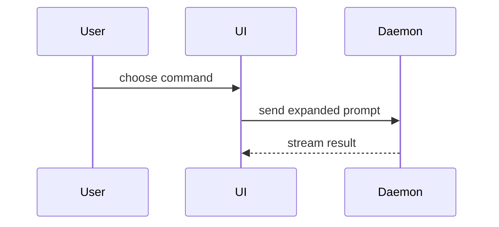

# Pull Request Body

## This repository's overrides

These win over the rest of this file.

- **The body uses `.github/pull_request_template.md`.** Fill its sections in its
  order. Do not add or rename headings.
- **Evidence mechanics are not owned here.** What each change class needs, where
  artifacts live, and how they are published are owned by
  `docs/agents/evidence.md`. Do not restate capture commands in the PR body.
- **Verification is not evidence.** `./scripts/verify <target>` passing belongs
  in Evidence only as the "After" half of a before/after pair.
- **Publishing:** `gh pr comment <number> -F <dir>/MANIFEST.md --attach
  <dir>/<image>#<alt text>`, refreshed with `--edit-last`. The body itself is
  set with `gh pr create --body-file <file>` or `gh pr edit <number>
  --body-file <file>`.
- **Domain language comes from `CONTEXT.md`**, via `docs/agents/domain.md`. Do
  not invent terms the glossary avoids.
- **No preamble.** The body starts at the `Summary` heading.

## The template

```markdown
## Summary

<diagram, diff-sketch, or tree>

## Evidence

- **Before:** <screenshot/output/failing test run>
  **After:** <screenshot/output/passing test run>

## Merge Danger

**Door:** <one-way or two-way>

<optional: description>

**Blast Radius:** <one-word description>

<optional: potential ramifications of merge>
```

## Sections

Skip all preambles and keep prose brief. Use the user's domain language from
`CONTEXT.md`.

### Summary

Pick the smallest view that makes the key point clear.

- Show logic or an algorithm as pseudocode:

```text
on(save)
  if content is unchanged
    return cached result
  write new content
  return fresh result
```

- Show runtime control flow as a call tree:

```text
submitForm
  createSession
    persistPrompt
    launchAgent
  navigateToSession
```

- Show UI structure as a component tree, including state and module boundaries
  that matter:

```text
<SessionPage> (apps/example/src/routes/session.tsx)
  useSessionEvents()
  <SessionToolbar>
    <RunSkillButton> (packages/ui)
```

- Show file responsibility or a broad refactor as a shallow file tree:

```text
src/
├── commands/       # parses user actions
├── sessions/       # owns session state
└── transport/      # sends API requests
```

- Show component interaction, control flow, or data flow with Mermaid:



- Use `diff` when the point is what changes and the surrounding shape already
  exists. Match the diff shape to the topic.

For a component change:

```diff
 <SessionPage>
   useSessionEvents()
   <SessionToolbar>
+    <RunSkillButton />
   <SessionTimeline>
+    <SkillResultCard />
```

For a file-layout change:

```diff
 src/
 ├── commands/
+│   └── show-me.ts       # expands the slash command
 ├── sessions/
-└── transport.ts
+└── transport/
+    ├── client.ts
+    └── stream.ts
```

For a call-tree or call-stack change:

```diff
 submitForm
   createSession
     persistPrompt
+    expandSkillMention
     launchAgent
-  navigateToSession
+  navigateToSession
+    subscribeToEvents
```

For a state or control-flow change:

```diff
 on(save)
-  write content
+  if content is unchanged
+    return cached result
+  write new content
+  invalidate cache
```

- Show the whole block when most of it is new, when omitted context would hide
  ownership or order, or when the user needs a copyable target shape:

```ts
function expandSkill(command: string): string {
  const skillName = command.slice(1);
  return `use the ${skillName} skill`;
}
```

#### Guidance

Place each visual next to the short text it supports. Keep only the calls,
files, props, states, and boundaries needed to answer the reviewer's current
question. You may use one of these, you may use several, it is unlikely you will
use all of them.

### Evidence

Concrete evidence that the change works. Show a before and after. Gate and
capture rules live in `docs/agents/evidence.md`.

Screenshots are S-tier when the environment is set up for it and the change is
visual.

Execution-based evidence is A-tier: test results, console output. Show the exact
test that failed before and passes now, using pseudocode. "Tests are green" on
its own is a claim, not evidence.

### Merge Danger

Describe whether the change is a one-way or a two-way door. You can walk back
through two-way doors, but not one-way doors. A PR that is cheap to roll back is
lower risk. Destructive actions and hard-to-reverse decisions are one-way doors:
schema migrations, removing a public API, deleting data, anything that ships
outward.

The blast radius is the potential impact or scope of the change. Consider all
possibilities: layout shift, breakage for consumers, mobile responsiveness,
background jobs, stored data formats.

State the call even when it is obvious. A stated call is one the reviewer can
disagree with; a hidden one is taken on trust, and the agent that wrote the
change is the one grading it.
