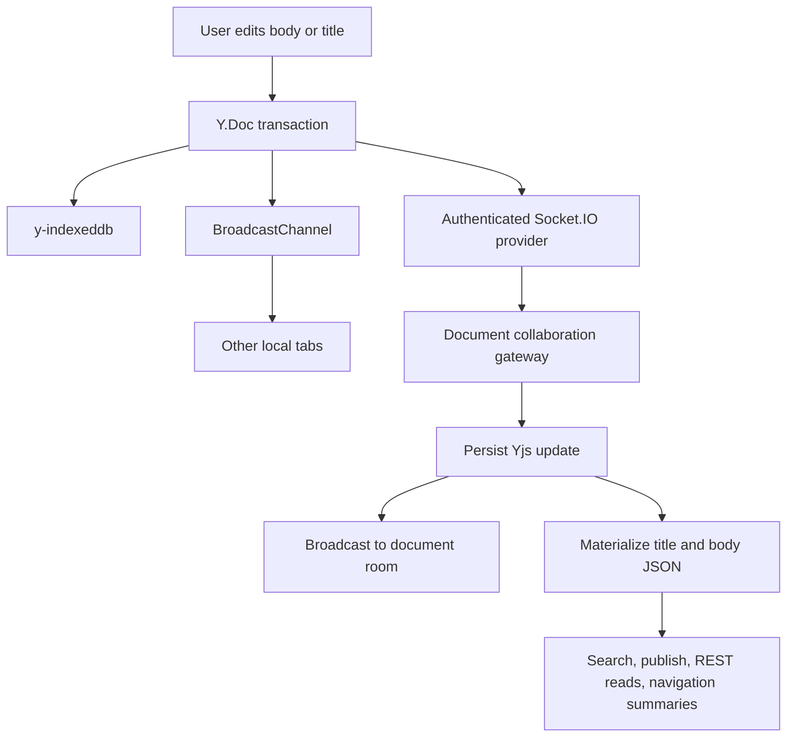

# Document Edit Flow

This document is the top-level implementation map for Camille collaborative document editing. Detailed subflows live under [`flows/`](./flows/).

## Entry Points

- Opening a document starts a document-scoped editing session.
- The title editing surface writes the Document Title into `meta.title` on the synchronized Y.Doc.
- The body editor mounts in collaboration mode and writes the Document Body into the synchronized body fragment.
- The authenticated Socket.IO provider joins the document room after workspace membership and document access checks.
- REST document commands continue to own archive state, hierarchy, permissions, sharing, and other non-editor metadata.

## High-Level Flow

## Main Flow

1. User opens a document for editing.
2. Browser creates one document-scoped Y.Doc.
3. `y-indexeddb` applies locally persisted updates.
4. BroadcastChannel connects sibling tabs in the same browser profile.
5. Socket.IO provider connects to the `/collaboration` namespace using the HTTP-only access cookie.
6. API verifies workspace membership and document access before joining `document:{documentId}`.
7. Browser and API exchange Yjs state vectors and missing updates.
8. Browser applies missing server updates and sends offline local updates missing from the server.
9. Editing session binds `meta.title` from the synchronized Y.Map.
10. The body editor mounts in collaboration mode with the synchronized body fragment.
11. Local title and body edits emit Yjs binary updates.
12. Local updates persist to IndexedDB, broadcast to same-browser tabs, and send to the API when connected.
13. API applies accepted updates to the active server Y.Doc.
14. API appends accepted updates to PostgreSQL with document sequence and SHA-256 deduplication.
15. API materializes `documents.title`, `documents.content_json`, search text, publish reads, and subdocument references from the merged Y.Doc.
16. Gateway broadcasts persisted updates to other sockets in the document room.
17. API periodically compacts update logs into Yjs snapshots without changing canonical document state.

## UI States

### Loading And Synchronizing

- Document editing session can show local cached content while the socket is connecting.
- Initial synchronization should distinguish loading server state from mounting an empty document.
- The body editor must not receive separate initial content in collaboration mode.
- Existing JSON content is converted into the Y.Doc only when the server initializes collaboration state for the first time.
- Server initialization also seeds the canonical title from `documents.title`.

### Editable

- Editable session allows title and body edits when the document is active, collaboration is ready enough for local Yjs writes, and the user has edit permission.
- Edits are ordinary Yjs transactions and converge across IndexedDB, BroadcastChannel, Socket.IO, and PostgreSQL.
- Optimistic local editing is allowed because reconnect synchronization transfers missing Yjs updates in both directions.

### Read-Only Or Permission Restricted

- Read-only sessions can receive and render synchronized collaborative state.
- Title and body editing controls are disabled or unavailable when the current user lacks edit permission.
- Permission is rechecked server-side for remote updates; client editability is not trusted.
- Permission revocation can leave local cached updates that the API rejects on reconnect.

### Offline And Reconnecting

- Cached collaborative documents can open and remain editable without an API connection.
- Offline changes stay in IndexedDB as Yjs updates.
- Reconnection uses state vectors to send only missing updates each way.
- Awareness, cursor, and presence state are ephemeral and may disappear during offline periods.

### Success

- Persisted updates are broadcast only after PostgreSQL append and projection refresh succeed.
- REST reads, search, publish, and navigation summaries eventually reflect the canonical Y.Doc.
- Duplicate, delayed, and out-of-order Yjs updates converge without user conflict resolution.

### Error

- Socket authentication failure prevents the client from joining the document room and remote sync remains unavailable.
- Document access denial prevents room join or update acceptance.
- IndexedDB failure removes local recovery guarantees but does not make server synchronization canonical.
- Projection failure means derived REST/search/publish state may lag and the Y.Doc remains canonical.
- Snapshot compaction failure should not drop uncovered updates; reconnect synchronization must still be possible from durable update data.
- Multi-instance deployments without cross-instance Socket.IO pub/sub can miss live broadcasts between API instances, while PostgreSQL remains the durable reconnect source.

## Responsive And Accessibility Notes

- Connection, offline, reconnecting, sync failure, and read-only states should be surfaced without relying on color alone.
- Disabled editing controls need accessible names or descriptions that explain read-only or unavailable state.
- Collaboration status should not steal focus from the title input or body editor while a user is typing.
- Recovery or reconnect notices should keep keyboard focus predictable and avoid blocking ordinary editing when local writes are still accepted.

## Acceptance Criteria

- [ ] Opening a document creates exactly one route-scoped Y.Doc for title and body collaboration.
- [ ] Existing `content_json` is converted into Yjs only during first server-side collaboration initialization.
- [ ] Collaboration-mode body editor does not receive separate initial content.
- [ ] Server initialization seeds the canonical title from `documents.title`.
- [ ] Browser sends its state vector and applies only missing server updates.
- [ ] Browser sends offline local updates missing from the server after applying server updates.
- [ ] Title edits write to `meta.title` and synchronize through the same Yjs update pipeline as body edits.
- [ ] Body edits write to the collaborative body fragment.
- [ ] IndexedDB stores Yjs updates for local recovery instead of replaceable JSON drafts.
- [ ] BroadcastChannel synchronizes updates across same-browser tabs without echo loops.
- [ ] Socket.IO update origins are not echoed back to the sender.
- [ ] API verifies workspace membership before document room join.
- [ ] API rechecks edit permission before accepting a remote update.
- [ ] API persists a Yjs update to PostgreSQL before broadcasting it to other sockets.
- [ ] Persisted updates include document sequence and SHA-256 deduplication.
- [ ] API materializes `documents.title`, `documents.content_json`, search text, publish reads, and subdocument references from the merged Y.Doc.
- [ ] REST content replacement is rejected after collaborative state exists.
- [ ] Archive state, permissions, hierarchy, and other non-editor metadata continue through REST optimistic-locking workflows.
- [ ] Cached collaborative documents can open offline and accept local edits.
- [ ] Reconnection transfers only missing Yjs updates in both directions.
- [ ] Recovery prompts and latest-wins content saves are disabled for collaborative documents.
- [ ] Awareness and cursor state are ephemeral and expire when clients stop sending updates.
- [ ] Every 100 persisted updates, API stores a compact Yjs snapshot and removes only covered updates.
- [ ] Multi-instance deployment uses Socket.IO Redis adapter or equivalent pub/sub before relying on live cross-instance broadcasts.

## Subflows

- [Document open](./flows/document-open.md)
- [Local edit](./flows/local-edit.md)
- [Remote update](./flows/remote-update.md)
- [Offline and recovery](./flows/offline-and-recovery.md)
- [Canonical and derived state](./flows/canonical-and-derived-state.md)
- [Operational boundary](./flows/operational-boundary.md)
- [Undo and redo](./flows/undo-redo.md)
- [Normal edit undo and redo](./flows/undo-redo-normal-edit.md)
- [Undo and redo command compensation](./flows/undo-redo-command-compensation.md)
- [Archive subdocument undo and redo](./flows/archive-subdocument-undo-redo.md)
- [Duplicate subdocument undo and redo](./flows/duplicate-subdocument-undo-redo.md)
- [Undo and redo session boundaries](./flows/undo-redo-session-boundaries.md)
