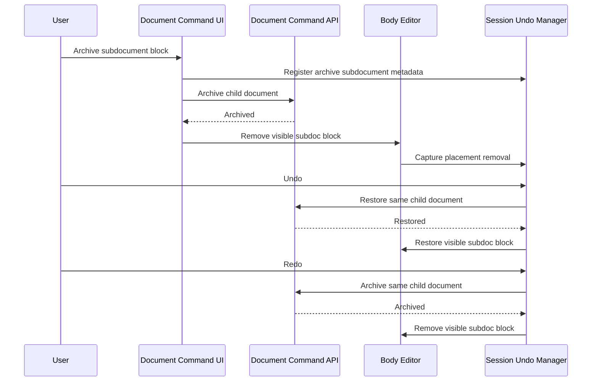

# Archive Subdocument Undo And Redo

This flow describes undo and redo for the visible placement effect of archiving a subdocument block.

## Undo After Archive

1. Archive command metadata identifies the archived child document.
2. Undo runs a restore compensating command for that same child document.
3. Only after restore succeeds does the editor restore the visible subdoc block placement.
4. If restore fails, the visible body remains unchanged and the user sees an Undo Failure Notice.

## Redo After Archive Undo

1. Redo uses the same command metadata.
2. Redo runs an archive compensating command for the same restored child document.
3. Only after archive succeeds does the editor remove the restored visible placement again.

Summary:

- archive undo restores the same archived child document before restoring the visible block
- archive redo archives the same child document before removing the visible block again
- visible body changes happen only after backend compensation succeeds
- failed restore or archive compensation leaves the current visible body unchanged
- archive undo/redo does not create a new child document identity
