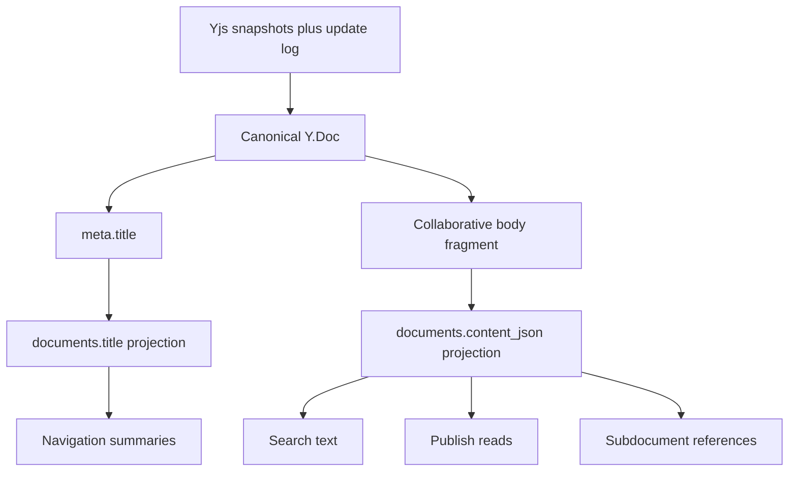

# Canonical And Derived State

This flow describes which state is canonical for collaborative documents and which fields are projections for existing read paths.

Summary:

- Yjs snapshots plus durable updates are canonical document state
- `meta.title` inside the Y.Doc is the canonical Document Title
- Collaborative body fragment inside the Y.Doc is the canonical Document Body.
- `documents.title` is a derived projection used by existing REST reads and navigation summaries
- `documents.content_json` is a derived projection used by existing REST reads, search, publish, and navigation paths
- normal REST document updates reject content replacement after collaborative state exists
- archive state, permissions, hierarchy, and other metadata continue to use REST optimistic locking
- subdocument commands remain REST workflows
- successful editor-visible command effects are committed into the Y.Doc so projections converge with command results
