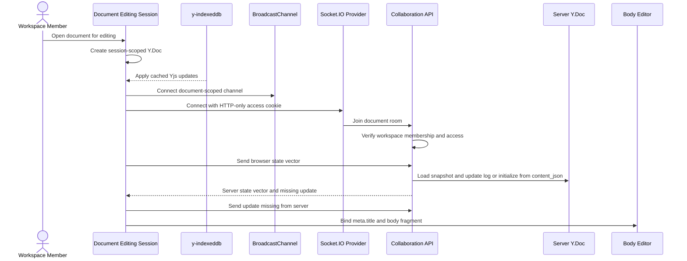

# Document Open

This flow describes how a document editing session creates and synchronizes the browser Y.Doc before the title and body editor bind to collaborative state.

Summary:

- browser creates one Y.Doc for the document editing session
- `y-indexeddb` applies locally persisted updates before or alongside remote sync
- BroadcastChannel connects tabs in the same browser profile for the same document
- Socket.IO connects to `/collaboration` with the HTTP-only access cookie
- API verifies workspace membership and document access before joining `document:{documentId}`
- client and server exchange state vectors to calculate missing updates
- server lazily initializes the first collaborative Y.Doc from existing `content_json`
- body editor does not receive separate initial content in collaboration mode
- existing JSON content is converted into the Y.Doc only during first server initialization
- server seeds `meta.title` from `documents.title` during first collaborative initialization
