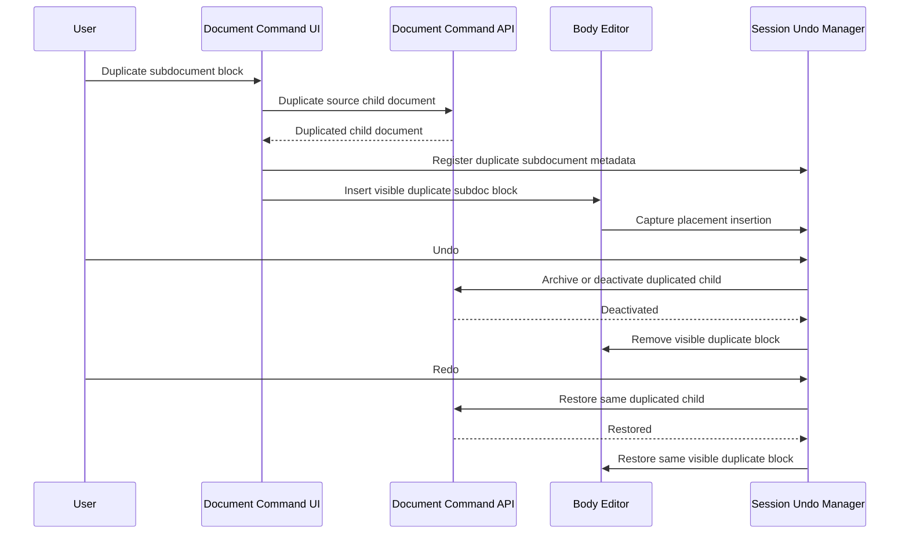

# Duplicate Subdocument Undo And Redo

This flow describes undo and redo for the visible placement effect of duplicating a subdocument block.

Duplicate currently creates a new backend document subtree and inserts a visible subdoc block in collaborative mode.

Compensated duplicate undo/redo uses session metadata to identify:

- the source subdocument,
- the duplicated subdocument,
- the anchor or placement identity,
- the parent/current document identity,
- validation context for permission and lifecycle checks.

Undo should remove the duplicate placement and deactivate or archive the duplicated subtree. Redo should restore the same duplicated subtree and placement when possible instead of creating a fresh duplicate identity.

Summary:

- duplicate undo targets the duplicated child document, not the source child document
- duplicate redo should restore the same duplicated child identity when possible
- redo should not create a fresh duplicate identity unless the design explicitly changes
- placement metadata ties visible body replay to the original insertion point
- failed deactivate, archive, or restore compensation leaves the visible body unchanged
