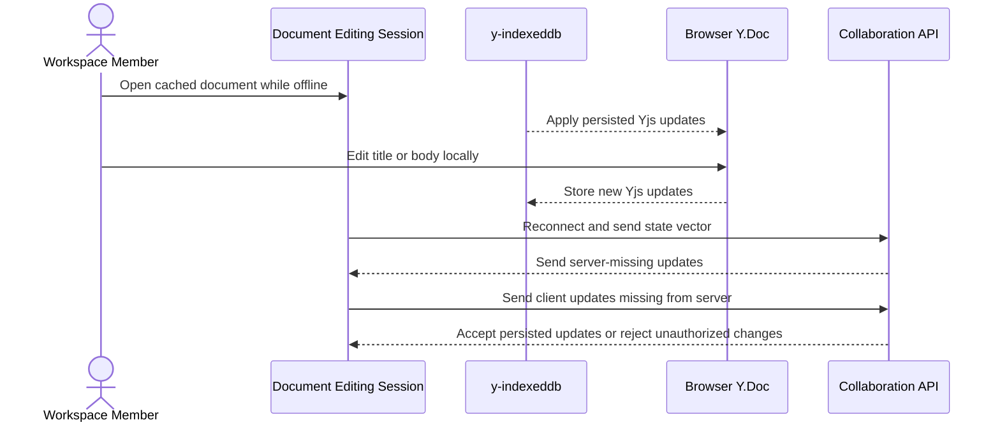

# Offline And Recovery

This flow describes how collaborative documents continue locally while disconnected and converge after reconnect.

Summary:

- IndexedDB stores Yjs updates instead of a replaceable JSON recovery draft
- cached collaborative document can open without the API
- cached editable document remains editable while offline
- reconnection uses state vectors to transfer only missing updates in both directions
- duplicate, delayed, and out-of-order updates converge through Yjs
- recovery prompts and latest-wins content saves are disabled for collaborative documents
- permission revocation can cause locally cached offline updates to be rejected after reconnect
- awareness and cursor state are ephemeral and expire when clients stop sending updates
