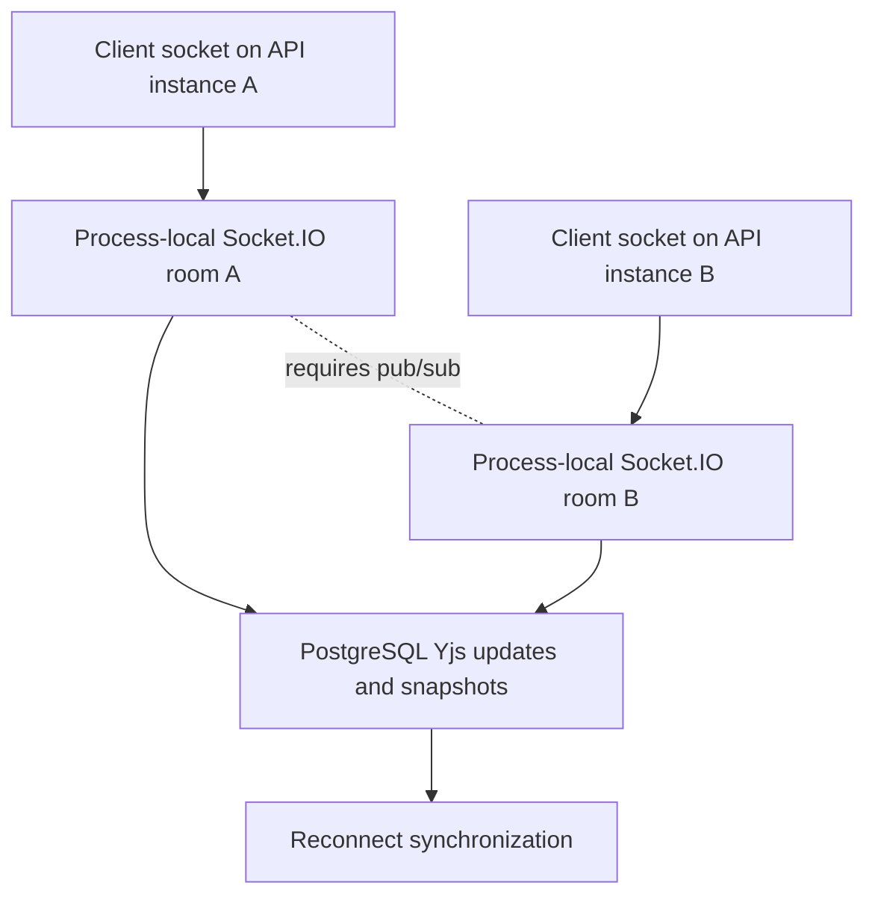

# Operational Boundary

This flow describes the current deployment boundary for active collaboration state and the requirement for multi-instance live fanout.

Summary:

- active server Y.Docs are process-local
- Socket.IO document rooms are process-local
- PostgreSQL update sequencing is the durable source for reconnect synchronization
- single-instance deployment can rely on process-local room fanout
- multi-instance API deployment requires a Socket.IO Redis adapter or equivalent pub/sub for live cross-instance broadcasts
- without cross-instance pub/sub, clients connected to different API instances may miss live broadcasts
- missed live broadcasts can still converge on reconnect through PostgreSQL-backed state-vector synchronization
- pub/sub is an operational requirement before treating multi-instance live collaboration as production-ready
