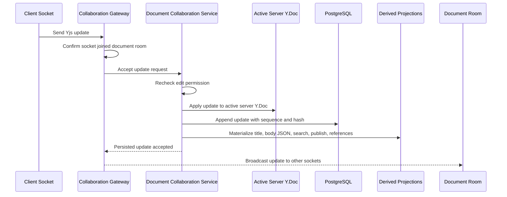

# Remote Update

This flow describes how the collaboration API accepts, persists, projects, and broadcasts a Yjs update received over Socket.IO.

Summary:

- gateway confirms the socket joined the target document room
- application service rechecks edit permission for each remote update
- accepted update is applied to the active server Y.Doc
- binary update is appended to PostgreSQL with document sequence and SHA-256 deduplication hash
- merged Y.Doc is materialized into derived projections for title and body JSON content
- `documents.title`, `documents.content_json`, search text, publish reads, and subdocument references refresh from the projection
- canonical server Y.Doc is not replaced by derived JSON content
- gateway broadcasts only after durable persistence succeeds
- every 100 updates, API stores a compact Yjs snapshot and removes covered updates
