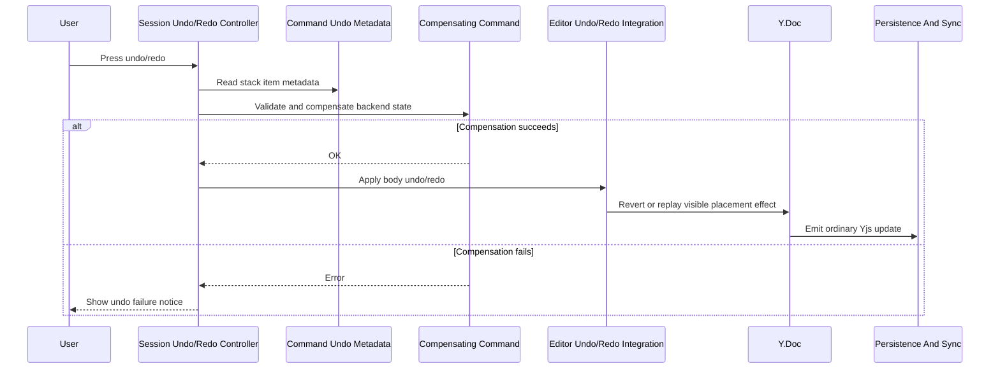

# Undo And Redo Command Compensation

This flow describes undo and redo entries that need backend document state to be restored or archived before replaying a visible placement effect in the current Document Body.

Document commands are undoable only for their visible placement effect in the current body. If a visible placement effect depends on backend state, the compensating command must succeed before applying the body undo or redo.

Current command metadata covers archive subdocument placement effects and duplicate subdocument placement effects.

Summary:

- command undo/redo starts from the current undo or redo stack item metadata
- metadata identifies the document command, affected child document, placement, and validation context
- compensation validates permission and lifecycle state before visible body replay
- body replay is blocked until compensation succeeds
- failed compensation leaves the visible Document Body unchanged
- failed compensation shows an Undo Failure Notice
- successful visible replay emits an ordinary collaborative Yjs update
- collaboration sync does not need a special undo transport
