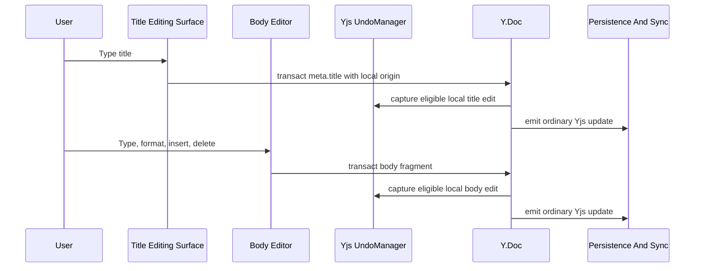
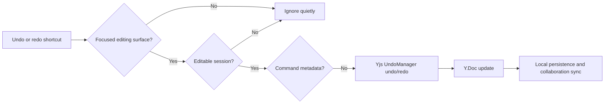

# Normal Edit Undo And Redo

This flow describes ordinary title and body edits that can be undone or redone without command compensation.

## Normal Local Edit

1. The user edits the title or body editing surface.
2. Title edits transact against `meta.title` with the local document edit origin.
3. Body edits transact into the collaborative body fragment.
4. The session `Yjs.UndoManager` captures the local transaction when the origin is eligible.
5. Remote, socket, broadcast, initialization, and system synchronization origins are excluded from the local undo stack.
6. The resulting Yjs update is persisted locally, broadcast to sibling tabs, and sent to the collaboration API when connected.
7. Server-side projections eventually refresh REST-readable title, content JSON, search, publish, and navigation state.

## Shortcut Handling

1. The session undo/redo controller listens for undo and redo shortcuts at the document level.
2. Cmd/Ctrl+Z runs undo.
3. Cmd/Ctrl+Shift+Z and Ctrl+Y run redo.
4. Shortcuts only run while the document is editable and focus is in an editing surface: title input or body editor.
5. Empty stacks, read-only sessions, archived documents, and unrelated focus targets are quiet.

## Undo Or Redo Without Command Metadata

1. The shortcut resolves the active undo or redo stack item.
2. If the entry has no command metadata, the session undo manager applies `undo()` or `redo()` directly.
3. The resulting Yjs update synchronizes like any other document edit.
4. Other collaborators see the result, but their local undo stacks do not record the original user's local history.

Summary:

- normal title and body edits use Yjs UndoManager directly
- only eligible local origins enter the session undo stack
- system and remote synchronization origins are excluded
- shortcut handling is scoped to editable document editing surfaces
- empty or unavailable undo/redo states do not show noisy notices
- undo/redo output is an ordinary collaborative Yjs update
