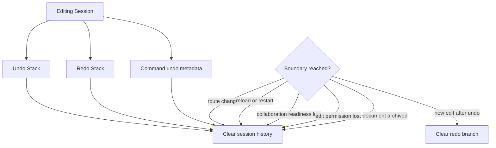

# Undo And Redo Session Boundaries

This flow describes when browser-local undo and redo history ends.

Undo and redo history is in memory only. It clears when:

- the document route changes,
- the page reloads or browser restarts,
- collaboration readiness is lost,
- edit permission is lost,
- the document becomes archived,
- a new document edit branches history after undo.

Persisted Yjs state can recover document content, but it must not recover the undo stack, redo stack, or command undo metadata.

Summary:

- undo and redo are scoped to one browser-local Editing Session
- undo stack, redo stack, and command metadata are not persisted
- Yjs document content persists independently from local undo history
- route changes and reloads start a new Editing Session
- permission or lifecycle loss ends editability and clears session history
- new edits after undo clear the redo stack because history branched
