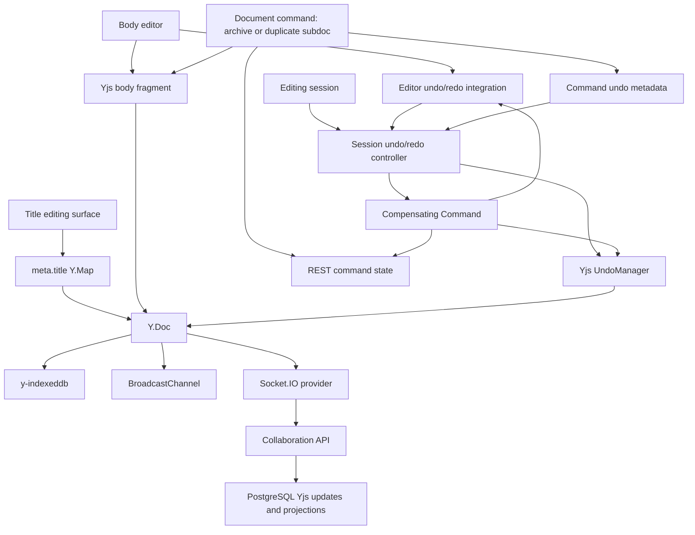

# Undo And Redo

This flow describes browser-local document undo and redo for one editing session. It complements the Yjs undo ADR by showing how the editing session, editor integration, session undo manager, command metadata, and collaboration sync fit together.

Undo and redo are editing-session behavior. They are not durable page history, audit-log rollback, or collaborator rollback.

## Components

- The document editing session owns the current undo and redo state.
- A session undo/redo controller owns shortcut handling and the session `Yjs.UndoManager`.
- `Yjs.UndoManager` tracks eligible local transactions against the collaborative `Y.Doc`.
- `meta.title` stores the Document Title inside the shared Yjs metadata map.
- The body editor writes Document Body edits into the collaborative Yjs body fragment.
- The editor undo/redo integration delegates compensated body undo/redo back to the editor when cursor and editor state matter.
- Command undo metadata stores in-memory context for command-related undo entries.
- Compensating Commands restore or archive backend document state before replaying visible placement effects.
- `y-indexeddb`, BroadcastChannel, and Socket.IO persist and synchronize resulting Yjs updates.

## High-Level Flow

## Scope

### In scope

- Browser-local undo and redo during one editing session.
- Title and body document edits captured from eligible local Yjs transactions.
- Shortcut handling for focused editing surfaces.
- Command metadata for visible placement effects caused by archive and duplicate subdocument commands.
- Compensating commands that make backend document state safe before replaying a visible placement effect.
- Synchronization of undo/redo results as ordinary Yjs updates.

### Out of scope

- Durable page history.
- Audit-log rollback.
- Collaborator rollback.
- Persisted undo or redo stacks.
- Undo of UI state such as selection, cursor position, menus, hover controls, or chrome visibility.
- Global undo across document changes.

## Acceptance Criteria

- [ ] Local title edits are captured when they transact against `meta.title` with an eligible local origin.
- [ ] Local body edits are captured when the body editor writes into the collaborative body fragment with an eligible local origin.
- [ ] Remote, socket, broadcast, initialization, and system synchronization origins are excluded from the local undo stack.
- [ ] Undo shortcut runs only while focus is in a title or body editing surface during an editable session.
- [ ] Redo shortcut runs only while focus is in a title or body editing surface during an editable session.
- [ ] Empty stacks, read-only sessions, archived documents, and unrelated focus targets are quiet.
- [ ] Undo or redo without command metadata applies the session `Yjs.UndoManager` directly.
- [ ] Undo or redo with command metadata runs required compensation before visible body replay.
- [ ] Failed compensation leaves the visible body unchanged and shows an Undo Failure Notice.
- [ ] Successful undo and redo results synchronize through local persistence, BroadcastChannel, Socket.IO, and PostgreSQL like ordinary document edits.
- [ ] Other collaborators see undo/redo document changes without recording the original user's local undo history.
- [ ] Undo and redo stacks clear at editing-session boundaries.

## Subflows

- [Normal edit undo and redo](./undo-redo-normal-edit.md)
- [Command compensation](./undo-redo-command-compensation.md)
- [Archive subdocument placement](./archive-subdocument-undo-redo.md)
- [Duplicate subdocument placement](./duplicate-subdocument-undo-redo.md)
- [Session boundaries](./undo-redo-session-boundaries.md)
